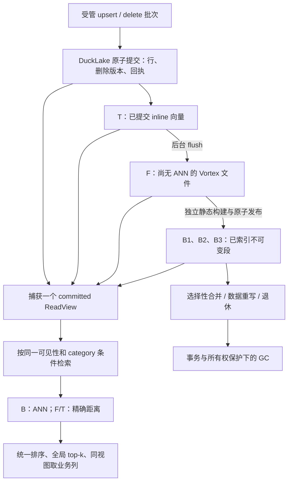

# DuckLake＋Vortex 总设计与 roadmap

本文是 DuckLake＋Vortex 实时向量检索的统一设计入口，按 **2026-11-03 的实现基线与截至 2026-11-06 的验证结果**整理。分项 proof 文档保留各次实验的历史；本文说明当前采用的方案、能力边界和后续顺序。

配套阅读：[ChatGPT Page](https://chatgpt.com/space/page_0c2fa263e4dc81919bfaea100e8008cd)。本文是后续随代码维护的仓库总纲。

**当前结论：本地原生基本链路已实现并通过端到端验证；持续写入下的长期维护稳态尚未完成。** 已支持提交后即时查询、后台 flush、独立 B 段构建、选择性合并、数据重写、受事务保护的 GC 和崩溃恢复。当前没有接入 SPFresh 原生在线增删改，也没有完成云端或分布式向量查询。

## 1. 基线与设计范围

实现基线为 [DuckLake Draft #74](https://github.com/AstroVela/ducklake/pull/74)，head 为 `2a9377062cddc0c222d8dd99e4d5efee3a298c76`。#74 的受控 A/B 未达到预设收益门槛，已撤回生产查询合并；其生产 `src/` 与 [#73](https://github.com/AstroVela/ducklake/pull/73) 的 `9819016e841ea79c8eea054415f4724fa2270e85` 相同。本文的“已验证”指该实现闭包的本地验证，不代表这些 Draft 已合入、发布或通过全部远端 CI。

当前限定：单进程独占 native DuckDB 元数据目录、本地受管 POSIX 文件、无分区／未加密的固定业务 schema、Float32 有限向量、平方 L2 距离。并发客户端与后台维护位于这一所有权范围内；多进程写者、跨主机 fencing、远程对象存储和分布式 ANN 不在当前验证范围。

```sql
CREATE TABLE lake.items (
    id BIGINT,
    embedding FLOAT[],
    category VARCHAR,
    payload VARCHAR
);
```

受管写入要求非 NULL `id`；`category`、`payload` 可以为 NULL。当前不是任意 schema、距离度量或 SQL 谓词的通用向量优化器。

本设计继承[原 Iceberg＋Vortex RFC](https://chatgpt.com/space/page_5ee0f8c698d08191a17198d45d152362)中“可查询增量＋不可变文件＋异步索引”的方向，以及参考 Qdrant 的 segment 生命周期和后台 optimizer 分工。实际落地改用 DuckLake 原生事务、inline 数据、删除可见性和元数据 WAL；原 RFC 的独立 WAL、HotVersions、Iceberg 物化与 ServingManifest 不能据此标为已实现。

## 2. 总体架构与职责

| 组件 | 当前职责 |
| --- | --- |
| DuckLake | 业务行与删除版本、事务快照、inline 数据、文件清单、写入回执、索引与维护元数据 |
| Vortex 文件 | 保存落盘后的向量和业务列；保留可验证的物理文件身份 |
| vortex-index／SPFresh | 从不可变物理输入构建、封存和查询静态 ANN generation |
| ReadView | 固定一次查询的原生快照、B/F/T 分区、可见性、过滤条件及资源所有权 |
| optimizer／maintenance | 阈值触发 flush、建索引、合并、重写，以及受预算限制的恢复与回收 |
| Vane 原生 provider | 通过安装后的 `vane.connect()` 暴露 SQL 入口；C++ 经 Rust ABI 调用 Vortex 查询核心 |



T/F/B 是**同一份逻辑数据在某个 ReadView 下的物理分区**，不要求客户端切换查询 API，也不要求最新写入等待 ANN 建成。F/T 的精确计算是预定查询路径；ANN 出错或结果不足不会触发扫描重试。

## 3. 数据状态与身份

| 状态 | 含义 | 查询方式 | 后台变化 |
| --- | --- | --- | --- |
| T | 已提交、尚未 flush 的 inline 数据 | 原始向量精确计算 | 达到策略阈值后 flush 到 F |
| F | 已落 Vortex 文件、尚未被当前 B 覆盖 | 原始向量精确计算 | 达到阈值且至少 65 个物理行后构建 B |
| B | 被已发布静态 generation 覆盖的文件集合 | 对可见且匹配的行执行 ANN，候选重新计算距离 | 选择性合并、数据重写、退休 |

命名索引允许 **零 B**。空表、只有 T、只有小 F、首次构建中和多 B/F/T 都使用同一个命名查询。小尾部可以继续留在 T/F；不会为了建 ANN 填充数据或放宽 65 行下限。

需要区分四种身份：

- 业务 `id` 表示逻辑键；受管写入中每个键只有一个当前版本。
- DuckLake `snapshot_id` 决定查询可见的逻辑版本，也包括只改变物理布局的快照。
- 文件 ID、URI、内容摘要、物理行数及行地址标识实际索引输入；绑定还校验表 UUID、向量字段 ID、类型、维度和距离度量。
- 索引 catalog revision 与 generation 标识索引发布状态；它们不等于业务快照号，也不使索引自动拥有最新删除可见性。

当前 catalog 使用严格的 manifest-v3 表示，支持零 B；格式或绑定不匹配直接失败，不提供旧格式兼容解码。详见[基本链路](native-vortex-basic-flow.md)、[多 B 段](native-vortex-segments-proof.md)及[原生 ReadView 实现](../src/storage/ducklake_vortex_read_view.cpp)。

## 4. 写入、ACK 与幂等

推荐业务入口是显式注册后的受管 mutation API：

1. 初始化索引、optimizer 和写入 catalog，在空表建立带维度的零 B 定义。
2. 调用 `ducklake_manage_vortex_writes` 注册空表所有权；配置写入预算与后台策略。
3. 调用 `ducklake_mutate_vortex_batch`，提交请求 ID、完整 upsert 行和待删除 ID。
4. 在同一原生事务内删除旧版本、插入新 T 行并登记回执；成功提交后返回 ACK。

upsert 是整行替换。一个批次内 upsert/delete 的 ID 必须非 NULL 且互不重复。同一个 ID 同时出现在两类操作中会失败。回执包含 `table_uuid, request_id, payload_hash, row_count, snapshot_id`；`row_count` 是请求操作数，删除不存在的键也计入。没有实际数据变化的删除可沿用当前快照号，但回执仍持久提交。

幂等身份为 `(table_uuid, request_id)`。相同内容重试返回原回执；更改内容复用请求 ID 会失败。重放旧 upsert 不会复活后来删除的数据，重放旧 delete 不会删除后来新写入的版本。提交冲突向客户端返回，内部提交重试次数为零；客户端可在新事务中显式重提同一请求。

受管表拒绝普通 SQL INSERT/UPDATE/DELETE、append API，以及 schema、rename、drop 变更；flush、重写与回收通过已有内部授权路径执行。非受管表保留普通 SQL／append 语义。这里复用 DuckLake 原生 MVCC 和元数据 WAL，没有第二份写入 WAL 或独立的逐键版本目录。

回执记录上限为**每个元数据 catalog 合计 100,000 条**，没有自动过期。快照过期和源文件 GC 不会删除回执；必须在扩大长期写入范围前确定回执保留与过期请求的语义。详见[受管写入](native-vortex-keyed-writes.md)和[写入实现](../src/storage/ducklake_vortex_write.cpp)。

## 5. 一次查询如何覆盖 B/F/T

查询捕获一个独立的 committed ReadView；调用方尚未提交的写入不会混入其中。该视图一次固定源文件、已提交 T 行、原生删除可见性、业务过滤条件、B generation 和资源所有权。

执行顺序：

1. 校验当前索引定义与物理输入绑定，把源数据划分为互不重叠的 B、F、T。
2. 在各分支 top-k **之前**应用该快照的删除可见性和业务过滤条件。
3. 每个 B 查询静态 ANN；F/T 对原始向量计算平方 L2 距离。
4. 用所持有的向量重新计算 B 候选距离，与 F/T 合成一个全局 top-k，按稳定物理行顺序打破距离相同的平局。
5. 从同一个 ReadView 取回类型化业务列，避免向量来自旧版本而 payload 来自新版本。

例如，B 中旧 `id=7` 被 upsert 后，旧物理行先被可见性过滤，新 T 行参与检索；不用末尾按业务 ID 去重来掩盖过期命中。该机制保证版本与过滤正确性，ANN 召回率仍需要独立测量，结果可以少于 k。

```sql
SELECT id, embedding, category, payload, distance
FROM ducklake_vortex_search(
    'lake', 'main', 'items', 'knn', [0,0]::FLOAT[], 10,
    category => 'A');
```

当前只有命名参数 `category` 的区分大小写等值条件是原生业务预过滤；外层 SQL `WHERE` 只过滤已返回命中，不等价于任意谓词下推后的 top-k。

`ducklake_vortex_search_diagnostics` 使用同一执行结果，固定返回一行 `diagnostics` 和类型化 `hits` 列表；即使零命中也能记录实际 `native_capture.snapshot_id`。普通 search 仍返回上面的五个业务／距离列。验证 oracle 使用**这次调用实际捕获的快照**，不会从前后提交水位中选择更有利的版本。

已捕获视图持有源字节、T 行和私有 generation lease。规范路径上的文件或索引经过 GC 后，旧视图仍可查询和延迟取列；新视图必须重新验证当前文件。当前会持有／复制受限输入，尚未完成大规模完全 out-of-core ANN 查询。详见[快照与维护观测](native-vortex-readview-maintenance-profile.md)及[SQL 查询入口](../src/functions/ducklake_vortex_search_function.cpp)。

## 6. 后台索引与物理维护

### 6.1 独立构建与原子发布

普通追加只把新 F 构建为 B₂，保留 B₁ 的 generation、描述符、产物内容和修改时间。B₁ 的身份校验仍有读取成本；“不重建旧 B”不表示发布过程完全不访问旧 B。

重型构建在元数据事务和发布锁之外执行。候选 generation 经过封存、输入／产物校验，再以 expected revision CAS 原子发布完整段集合。失败、取消或并发发布冲突不会暴露半套索引。发布成功但响应丢失时，恢复检查持久发布身份，不重复构建已经提交的 generation。

### 6.2 三段预算下的选择性合并

当前最多三个 B，所有段共享物理行、源字节、向量字节与产物预算。新 F 达到建索引条件但段槽已满时，optimizer 先选择两个最小 B 做独立合并任务；未选中的 B 保持不变。后续任务重新检查输入，再追加 F。

索引合并保留源文件与物理行地址，因此**不会释放已删除版本占用的源物理容量**。显式全量重建仍可由操作员调用；普通增量路径不依赖每次重建全部 B。

### 6.3 数据重写、稀疏段与退休

启用数据 compaction 策略后，按已有阈值选择可回收候选：

| 选中 B 的剩余可见行 | 计划 |
| --- | --- |
| 0 | 退休该 B；源文件继续遵守原生快照保留规则 |
| 1–64 | 显式重写为 F，不构建 SPFresh generation |
| 至少 65 | 重写可见源数据并构建替代 B |

整文件已不可见时还可走已验证的文件裁剪路径。原生文件清单和索引引用在同一发布事务更新，未选中 B 不变。`rewrite_f` 在规划时显式选择，不由 ANN 失败触发。

物理重写从计划选择、持久任务登记、源捕获到发布持有现有受管写者 reservation，避免后续 mutation 使选中非空输入变空。该范围会影响前台 ACK 等待；独立 B 构建和索引合并不持有这份受管写者 reservation。当前没有生产写延迟保证。

详见[选择性合并](native-vortex-segment-merge-proof.md)、[索引与数据重写](native-vortex-index-rewrite-proof.md)、[稀疏 B→F](native-vortex-sparse-rewrite-proof.md)、[文件裁剪](native-vortex-prune-files-proof.md)及[规划串行化](native-vortex-rewrite-planning.md)。

## 7. GC、事务保护与崩溃恢复

### 7.1 三类回收与共享预算

maintenance 复用现有单 worker，对 build 恢复／回收、退休 generation、源快照／文件回收共享每轮对象与字节预算，并轮换首先服务的类别。预算计算完成的回收对象／字节，不是所有校验读取、WAL 写入、线程数或进程 RSS 的上限。文件大于剩余字节预算时继续待处理，不绕过预算删除。

源保留策略默认关闭，显式开启后是 **catalog 范围**，会影响同 catalog 的非向量 DuckLake 表。快照保留数量与最小年龄必须按业务设置；测试中的保留两个快照、年龄零不属于生产建议。

### 7.2 删除前重新检查

源 collector 按以下顺序关闭入口：**publication exclusive → ReadView capture admission exclusive → transaction-start gate exclusive → 普通事务检查**。readiness 探测不能代替删除前的独立检查；仍有普通事务就暂缓，不穿透长事务删除文件。

只回收原生删除队列和持久删除意图登记的受管文件，不扫描目录后猜测 orphan。删除前校验受管根目录、路径／文件类型、引用、文件身份、大小与 SHA-256，拒绝符号链接等不满足所有权条件的对象。意图先提交，再 unlink 并同步父目录，最后原子确认队列、意图和统计。仅已登记意图允许恢复时处理“文件已不存在”。

### 7.3 事务结束后的唤醒

#73 在观察到阻塞事务时原子登记一次性回调。观察到的事务首次结束后，在事务管理器锁外通知 worker；通知只请求重新探测，不授权 GC。新的／剩余事务、引用和文件身份仍需重新检查。

回调绑定弱 runtime 引用和 maintenance profile 身份，取消或被新 registration 取代后忽略。wake epoch 防止通知发生在探测结束与进入等待之间而丢失；既有 100 ms idle wait 和预算保持不变。

### 7.4 持久状态与恢复边界

原生元数据保存命名索引、generation／引用、build／rewrite 所有权、optimizer／maintenance 策略、写预算、受管表、请求回执、源保留策略和删除意图。候选产物与删除意图遵守持久登记协议，不把任意残留目录当作可接管工作。

提交前失败回滚，提交后丢失 ACK 通过回执／发布身份核对。原生元数据 WAL 恢复已提交状态；进程重启本身不启动后台工作，需要显式 `ducklake_resume_vortex_optimizer` 和 `ducklake_resume_vortex_maintenance`。错误或取消停止对应调度；resume 重新检查持久状态和输入，不静默重放失败任务。

详见[源保留与删除协议](native-vortex-source-retention.md)、[事务完成唤醒](native-vortex-transaction-gc-wakeup.md)、[自动全链路与 SIGKILL](native-vortex-automatic-flow.md)。早期 proof 中被后续更改的锁顺序、段数或 manifest 版本，以本基线代码及后续文档为准。

## 8. 资源边界与运行入口

以下是当前原型的硬边界，不是生产容量承诺：

| 项目 | 当前边界 |
| --- | --- |
| 向量 | Float32，有限分量，维度 1–4096，平方 L2 |
| 查询 k | 1–64 |
| 新建 SPFresh B | 65–100,000 个物理行，并满足其他全局预算 |
| B 段数 | 每个命名计划最多 3 个 |
| 物理行／向量 | 全局最多 100,000 行、64 MiB 向量；维度 d 的行上限还受 `floor(64 MiB / (4*d))` 约束 |
| 编码源／索引产物 | 分别全局 64 MiB，不按 B 段数倍增 |
| catalog manifest | 1 MiB |
| mutation 批次 | 1–1,000 个操作，规范化内容最多 4 MiB |
| 请求回执 | 每个元数据 catalog 合计 100,000 条，不自动过期 |
| T/F 写入配额 | 显式配置；提交前对现有物理输入和保留 inline 版本重新 admission |

没有扩大预算就支持无限数据增长的结论。源／索引 GC 排空也不等于总磁盘有界：回执、原生元数据／WAL、调用方 reference JSON 有独立生命周期。上述输入限额同样不构成进程 RSS 上限。

安装后入口、provider 组合及完整配置步骤见 [Vane 原生接入](vane-native-vortex-proof.md)和[自动链路示例](native-vortex-automatic-flow.md)。当前验证使用非 editable 安装、匹配的 Vane／DuckLake／Vortex providers 和显式 `VANE_RUNNER=local-fast`。本向量路径使用原生 C++／Rust 调用，不为每次查询启动 Python 子进程或进行 JSON 文件交接。普通 DuckLake 的其他 Ray 读路径不等于本设计的分布式 ANN 已接通。

当前依赖身份以 [`vane-native-vortex.toml`](../vane-native-vortex.toml)、[Rust 依赖](../src/vortex_query/Cargo.toml)及 [native CI workflow](../.github/workflows/VaneNativeVortex.yml)为准；历史 proof 的 pin 表仅对应当次验证。Vortex 索引复用 `vortex-index` 分支演进出的 `vortex-index`／`vortex-index-spfresh` 实现，不能把通用 Vortex 文件格式直接等同于已建 ANN。

## 9. 已有验证与仍未关闭的问题

### 9.1 功能与恢复

最后的安装态资格验证覆盖基本链路、append、源保留、受管写入、自动维护和停滞诊断六组，包括 38 个 native source case、13 个 maintenance case、261 个 SQL assertion block、11 个快照／计时 oracle 测试、5 个文件计量测试和 4 个 A/B 分析测试。Vane base launcher 分进程通过 1,222 个非 Ray 和 32 个 Ray 测试，另有 15 个可选依赖跳过；这些 Ray base 测试不代表分布式 ANN 资格验证。

已覆盖独立 B₂ 不重建 B₁、原子发布竞争、取消、实际 SIGKILL、提交后丢 ACK、旧请求重放、普通事务阻止 GC，以及旧 ReadView 在规范文件／generation GC 后继续查询。详见[#74 最终资格记录](native-vortex-maintenance-probe-ab.md#final-installed-qualification-after-withdrawal)。

### 9.2 当前生产代码对应的 30 分钟观察

下表是 #73 的独立本地 trace；#74 撤回查询合并后生产源码与其相同，但没有为恢复后的包再声称一次新的 30 分钟测量。配置为 512 个活跃键、8D、4 个读者，maintenance 每轮 2 对象／64 MiB；T/F 配额分别为 256／1,024 行，字节配额分别为 4／64 MiB。结果仅适用于这个负载与配置。

| 指标 | 观察 |
| --- | --- |
| 实际写入阶段 | 1,800.275 秒 |
| 成功批次／mutation 操作 | 1,633／261,280，无拒绝尝试 |
| 查询 | steady 76,160；含 drain 76,595 |
| 实际 ReadView 快照／跨提交窗口查询 | 4,900／4,948 |
| Canary／exploration 最低召回 | 1.0／0.9，均通过既有 0.8 门槛 |
| 停写后 drain | 63.003 秒，通过 90 秒门槛；源快照／删除队列／意图排空 |
| 最终逻辑行／旧请求重放 | 512 行，均通过 |
| 写入结束 eligible snapshot 积压／峰值 | 613／614 |
| 写入阶段积压拟合斜率 | **+16.95 个快照／分钟** |

这证明受限混合负载下查询与恢复链路可用，停写后可以排空；**尚不能证明持续写入时积压有界**。期间 source GC 的 wall time 为 192.593 秒，其中元数据 73.707 秒、快照过期 70.551 秒，提示继续调查历史增长后的元数据／过期成本。父子计时重叠，不能相加后推断 CPU 占用或因果性能收益。完整数据见[事务唤醒验证](native-vortex-transaction-gc-wakeup.md)。

### 9.3 已撤回实验与开放故障

#74 在同一只读元数据与任务输入下做 6 个 case、3,840 次主要探测的交替配对 A/B。中／大规模四个 case 的完整读探测中位收益只有 0.17%–1.26%，未满足事先声明的收益、区间和胜出轮数要求，因此撤回 policy/backlog 查询合并；只保留测试基准。该实验没有执行实际 GC，不能回答 `DeleteSnapshots` 或整轮 maintenance 的优化收益。

另有一份早期 512 行／8D 混合负载发生无完成事件的停滞，缺少失败现场栈，尚未定位；后续重复成功、回放成功与最新 trace 无停滞不等于已修复。已有受控栈采集与 watchdog 证据保留机制，后续继续保留。详见[受控 A/B](native-vortex-maintenance-probe-ab.md)与[开放停滞诊断](native-vortex-stall-diagnostics.md)。

当前没有与 Turbopuff 同数据／同硬件／同质量门槛的对照结果，也不能把这些小规模 fixture 的召回推广为任意数据集的质量保证。

## 10. 统一 roadmap

本表重新按 DuckLake 实际路线编号；“已验证”均受第 1、8、9 节边界限制。原 Iceberg RFC 的阶段目标不能逐项直接标记完成。

| 阶段 | 目标与当前状态 | 退出条件／剩余工作 |
| --- | --- | --- |
| R0 原生文件与静态索引 | **已实现并验证**：Vortex 文件、物理身份、静态 SPFresh、原生 ABI、命名索引 | 保持 provider 与依赖闭包可重建；发布／合入单独检查 |
| R1 实时基本链路 | **已实现并验证**：零 B、即时 T/F 查询、受管 upsert/delete、回执、ReadView、写入背压 | 固定 schema／单进程范围内已有端到端及恢复证据 |
| R2 多 B 与自动维护 | **已实现并验证**：独立新增 B、三段预算、选择性合并、自动 flush/build | 保持追加不重建未选中 B、同视图全局 top-k 和现有预算 |
| R3 物理回收与读者保护 | **已实现并验证**：重写、稀疏 B→F、退休、意图 GC、旧视图、事务完成唤醒 | 已通过受控取消／崩溃边界；持续吞吐问题转入 R4 |
| R4 长期维护稳态 | **因本机负载波动暂缓，未完成**：[文件名预筛选](native-vortex-filename-prefilter.md)通过每侧 53,322 项路径 oracle 和 2,144 项真实元数据检查；预先提交协议后的受控 A/B 完成 768 次主采样，两个目标改善 5.28%／15.70%，但一个对照增加 3.84%，按规则撤回候选。生产引用检查未改，CPU／线程／事务／预算保持 | 稳定资源环境具备后再恢复 A/A、性能 A/B 与长期稳态验证；既有 A/A 未达 2% 门槛、候选撤回、积压有界与开放停滞未关闭的结论均保留 |
| R5 容量与产品契约 | **当前优先推进功能与契约，未完成**：先做[确定性维度／查询矩阵](native-vortex-functional-matrix.md)，覆盖 1／8／128／4,096 维、B/F/T、可见性、过滤、k 与拒绝边界；性能与长期容量验证暂缓 | 先按精确 oracle 验收功能，再明确回执保留及过期请求、reference／WAL 管理、容量 admission；延迟、吞吐及资源稳态待稳定环境 |
| R6 云端与分布式 | **未完成**：远程对象所有权、远程持久日志／发布协议、fencing、缓存、Vane 分布式 ReadView | 单独设计远程原子性与故障模型；固定视图 fan-out、读位置等待、owner 故障转移和分布式 top-k 的端到端验证 |
| R7 SPFresh 原生在线更新 | **候选后续路线，未接入** | 先证明相对独立静态 B 的必要性；设计可持久化版本、并发快照、撤销／恢复与 GC 协议，再验证原生增删改接口 |

原 RFC 的静态索引、实时可见、B/F/T、compaction／GC 目标在 R0–R3 有对应实现；其 Iceberg 专属物化、云端 fencing 和分布式 serving 并未因 DuckLake 本地链路通过而完成。保留原 RFC 作为历史来源，本文件作为 DuckLake 路线的总纲。

“可增量接收业务更新”已经成立：新版本进入 T，再经 F 成为独立 B。它与“直接调用 SPFresh 原生在线更新”是两个不同交付项；当前 roadmap 不把后者作为本地基本链路的前置条件，也不承诺未经验证就替换现有方案。

## 11. 下一份验证性 Draft PR

**按 2026-11-06 的用户安排，暂缓依赖稳定资源负载的项目，先推进 R5 的确定性维度与查询契约。** R4 的相同基线 A/A、优化 A/B、30 分钟与更长持续写入稳态验证先不启动；既有失败、撤回及未关闭的问题保留，不能标成已完成。R5 的延迟、吞吐和长期容量结论同样等待合适环境，功能与生命周期契约可以先行。

1. 首份[功能矩阵](native-vortex-functional-matrix.md)固定 1／8／128／4,096 维、k=1／64、六种 category 选择和九个 T/F/B／更新／重放／重开阶段；以独立客户端模型、精确平方 L2 和实际 ReadView 快照验收，不设耗时门槛。
2. 检查独立 B2 不重建 B1，B1+B2+F+T 的路由、过滤和统一 top-k，以及 B/F/T 中旧版本删除和原生事务隔离。零 B 必须精确，ANN 保留既有 fixture recall ≥0.8，业务列和可见性始终严格相等。
3. 验证维度、有限分量、k、过滤参数及 mutation 操作／字节上限的拒绝；失败不改变业务行、不留下回执，后续合法请求仍可用。保留 CPU 6–11、线程、事务保护、现有预算及显式维护操作。
4. 后续独立推进回执保留／过期请求契约、reference 与 WAL 生命周期、容量 admission 等可确定性验收的工作。回执过期需要明确旧请求如何拒绝，不能直接删除记录后允许重放；每项先写清语义再实现，不加不必要的兼容分支或 fallback。
5. 有稳定资源环境后再恢复 R4 测量：单独预先声明相同基线 A/A 与过期阶段归因，不混合旧实验或放宽门槛；可信候选再进入性能 A/B 与长时间持续写入验证。

R4 仍是性能与长期稳态的开放项，但不再阻塞 R5 的功能契约工作。R6 需要独立远程与分布式设计，R7 按收益证据决定；目前不改变本地所有权范围、质量门槛或预算。

## 12. 文档与实现导航

| 入口 | 用途 |
| --- | --- |
| [基本链路](native-vortex-basic-flow.md)／[安装态入口](vane-native-vortex-proof.md) | 从空表到 T/F/B 的命名 SQL 查询 |
| [受管写入](native-vortex-keyed-writes.md)／[自动全链路](native-vortex-automatic-flow.md) | 业务 mutation、配置、幂等与自动维护 |
| [多 B](native-vortex-segments-proof.md)／[选择性合并](native-vortex-segment-merge-proof.md) | 静态索引的增量组织与段预算 |
| [数据重写](native-vortex-index-rewrite-proof.md)／[稀疏重写](native-vortex-sparse-rewrite-proof.md) | 回收被替换／删除版本的物理容量 |
| [源保留](native-vortex-source-retention.md)／[事务唤醒](native-vortex-transaction-gc-wakeup.md) | 文件删除、读者保护与最新持续验证 |
| [快照与计时](native-vortex-readview-maintenance-profile.md)／[A/B 决策](native-vortex-maintenance-probe-ab.md) | 实际查询版本、阶段观测与已撤回实验 |
| [实际 source GC 成本](native-vortex-source-gc-cost.md) | 从相同输入恢复，区分快照与文件历史规模，定位下一项查询优化 |
| [过期窗口候选 A/B](native-vortex-expiry-interval.md) | 两种方案的等价性、受控比较、撤回决定和可复现测试引用 |
| [有序快照查找 A/B](native-vortex-expiry-lookup.md) | 区间 oracle、元数据／内存开销、对照门槛失败与 A/A 后续验证 |
| [相同二进制 A/A 精度](native-vortex-source-gc-aa.md) | 冻结协议、重点／完整矩阵、区间与分段检查、进程观测和后续隔离方案 |
| [固定 CPU 集合 A/A](native-vortex-source-gc-affinity.md) | affinity 继承／恢复、线程设置保留、重点阶段结果与未启动完整矩阵的门槛 |
| [独立元数据重复诊断](native-vortex-source-gc-metadata.md) | 128 次独立 trace、外层 SQL 守恒分类、显式规划拆分及 SQL 范围外开销的后续验证 |
| [引用检查内部诊断](native-vortex-reference-diagnostics.md) | 私有真实调用计时、Fetch／路径循环拆分、默认构建资格校验与后续否定预筛选验证 |
| [文件名预筛选 oracle 与 A/B](native-vortex-filename-prefilter.md) | 独立路径／真实元数据等价性、匹配链接的 12 输入 A/B、对照门槛失败与撤回决定 |
| [确定性维度与查询契约](native-vortex-functional-matrix.md) | 不依赖稳定负载的 R5 功能验收、B/F/T、过滤与拒绝边界 |
| [原生查询核心](../src/vortex_query/src/lib.rs)／[ReadView](../src/storage/ducklake_vortex_read_view.cpp)／[optimizer](../src/storage/ducklake_vortex_optimizer.cpp) | 对照实现与当前常量 |

后续能力或验证结论变化时，同时更新本文的基线、roadmap 状态、边界和证据入口。单次 proof 的历史结果继续保留；被撤回的实现和未关闭的失败不在总纲中写成已完成。
