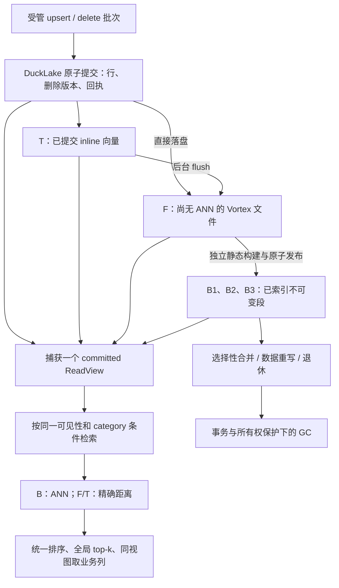

# DuckLake＋Vortex 总设计与 roadmap

本文是 DuckLake＋Vortex 实时向量检索的统一设计入口，基于 #95 合入后的开发提交 `c0fa417`。分项 proof 文档保留各次实验的历史，本文说明当前采用的方案、能力边界和后续顺序。

本文是随代码维护的仓库总纲。初稿阅读副本见 [ChatGPT Page](https://chatgpt.com/space/page_0c2fa263e4dc81919bfaea100e8008cd)。

**当前结论：本地原生基本链路已实现并通过端到端验证；持续写入下的长期维护稳态尚未完成。** 已支持提交后即时查询、后台 flush、独立 B 段构建、选择性合并、数据重写、受事务保护的 GC 和崩溃恢复。生产仍使用静态 SPFresh；本轮新增独立的 R7 原生增删／重开／旧视图组件验证，尚未接入生产 SQL 或完成 LIRE 重平衡。云端与分布式向量查询仍未完成，R6 按当前优先级暂缓。

## 1. 基线与设计范围

本统一设计首次合入 `dev/ducklake-vortex` 的提交为 `d0c3a5f7ffb9fa71591ac7b9b5a9de0ba517993b`。#71（`ff367dbd`）合入实际查询快照和维护计时，#72（`deb91458`）合入源保留查询优化和 worker 等待计时，#73（`dfd6bd30`）合入事务结束后的 GC 唤醒。#74 已将 policy/backlog 查询合并的撤回结论和历史证据链接合入开发分支，其生产 `src/` 与 `dfd6bd30` 一致。安装态回归及长测各自对应的提交见第 9 节。[开发基线](https://github.com/AstroVela/ducklake/commit/d0c3a5f7ffb9fa71591ac7b9b5a9de0ba517993b)

#84 增加 inline FLOAT／DOUBLE 的显式浮点解析，并以 Float64 累加密集向量的平方 L2，再返回 Float32 距离。确定性测试覆盖 1／8／128／4,096 维以及 B/F/T、过滤和实际 ReadView，沿用既有资源及召回门槛。[数值修复与功能矩阵](native-vortex-functional-matrix.md)

#88 为原生查询私有副本登记所有权，增加活跃文件锁和有预算的显式崩溃回收。[查询 scratch 生命周期](native-vortex-query-scratch-lifecycle.md)

开发基线 `1848e868` 已合入 #89 的请求 UUID 校验和原子表退休。#90 在原生快照过期事务中清理失去最后一个历史引用的表级配置。[#89 合入提交](https://github.com/AstroVela/ducklake/commit/1848e868c6f1dfce47d1debdb772292cced2ae2c) · [退休后的原生历史与物理回收](native-vortex-retired-history.md)

#91 为远程对象登记、原子发布、跨 owner 引用保护及回收定义协议，并用可执行模型验证有界交错。[R6 远程发布协议与独立模型](native-vortex-remote-publication.md)

#92 增加独立的 PostgreSQL／S3 broker 原型，用隔离服务验证原子发布、签名票据、读者 pin 和精确版本回收。[R6 后端与组件验收](native-vortex-postgres-s3-backend.md)

#93 复用 broker 的 PostgreSQL 事务，在独立组件中验证类型化元数据、表 UUID 和完整 uint64 请求 epoch。验收覆盖原回执、原子退休与同名重建。[类型化元数据验收](native-vortex-postgres-typed-lifecycle.md)

#94 将 typed UUID、字段和源快照绑定到 source、generation、发布与 ReadView。组件回归覆盖跨 UUID 隔离、规范引用的原子退休、旧视图和精确版本 GC。[身份与 ReadView 验收](native-vortex-bound-readviews.md)

#95 在新建 `layout=1` schema 上增加 reader session、精确版本 GET 授权、持久副本验收和受预算的 pin 回收。[Reader session 验收](native-vortex-reader-sessions.md)

当前生产验证范围为单进程独占 native DuckDB 元数据目录、本地受管 POSIX 文件、无分区／未加密的固定业务 schema、Float32 有限向量和平方 L2 距离。并发客户端与后台维护位于这一所有权范围内。

```sql
CREATE TABLE lake.items (
    id BIGINT,
    embedding FLOAT[],
    category VARCHAR,
    payload VARCHAR
);
```

受管写入要求非 NULL `id`；`category`、`payload` 可以为 NULL。当前不是任意 schema、距离度量或 SQL 谓词的通用向量优化器。

本设计继承[原 Iceberg＋Vortex RFC](https://chatgpt.com/space/page_5ee0f8c698d08191a17198d45d152362)中“可查询增量＋不可变文件＋异步索引”的方向，以及参考 Qdrant 的 segment 生命周期和后台 optimizer 分工。实际落地改用 DuckLake 原生事务、inline 数据、删除可见性和元数据 WAL；原 RFC 的独立 WAL、HotVersions、Iceberg 物化与 ServingManifest 不能据此标为已实现。

## 2. 总体架构与职责

| 组件 | 当前职责 |
| --- | --- |
| DuckLake | 业务行与删除版本、事务快照、inline 数据、文件清单、写入回执、索引与维护元数据 |
| Vortex 文件 | 保存落盘后的向量和业务列；保留可验证的物理文件身份 |
| vortex-index／SPFresh | 从不可变物理输入构建、封存和查询静态 ANN generation |
| ReadView | 固定一次查询的原生快照、B/F/T 分区、可见性及资源所有权 |
| optimizer／maintenance | 阈值触发 flush、建索引、合并、重写，以及受预算限制的恢复与回收 |
| Vane 原生 provider | 通过安装后的 `vane.connect()` 暴露 SQL 入口；C++ 经 Rust ABI 调用 Vortex 查询核心 |



T/F/B 是**同一份逻辑数据在某个 ReadView 下的物理分区**，不要求客户端切换查询 API，也不要求最新写入等待 ANN 建成。F/T 的精确计算是预定查询路径；ANN 出错或结果不足不会触发扫描重试。

## 3. 数据状态与身份

| 状态 | 含义 | 查询方式 | 后台变化 |
| --- | --- | --- | --- |
| T | 已提交、尚未 flush 的 inline 数据 | 原始向量精确计算 | 达到策略阈值后 flush 到 F |
| F | 已落 Vortex 文件、尚未被当前 B 覆盖 | 原始向量精确计算 | 达到阈值且至少 65 个物理行后构建 B |
| B | 被已发布静态 generation 覆盖的文件集合 | 对可见且匹配的行执行 ANN，候选重新计算距离 | 选择性合并、数据重写、退休 |

命名索引允许 **零 B**。空表、只有 T、只有小 F、首次构建中和多 B/F/T 都使用同一个命名查询。小尾部可以继续留在 T/F；不会为了建 ANN 填充数据或放宽 65 行下限。

需要区分四种身份：

- 业务 `id` 表示逻辑键；受管写入中每个键只有一个当前版本。
- DuckLake `snapshot_id` 决定查询可见的逻辑版本，也包括只改变物理布局的快照。
- 文件 ID、URI、内容摘要、物理行数及行地址标识实际索引输入；绑定还校验表 UUID、向量字段 ID、类型、维度和距离度量。
- 索引 catalog revision 与 generation 标识索引发布状态；它们不等于业务快照号，也不使索引自动拥有最新删除可见性。

当前 catalog 使用严格的 manifest-v3 表示，支持零 B；格式或绑定不匹配直接失败，不提供旧格式兼容解码。详见[基本链路](native-vortex-basic-flow.md)、[多 B 段](native-vortex-segments-proof.md)及[原生 ReadView 实现](../src/storage/ducklake_vortex_read_view.cpp)。

## 4. 写入、ACK 与幂等

推荐业务入口是显式注册后的受管 mutation API：

1. 初始化索引、optimizer 和写入 catalog，在空表建立带维度的零 B 定义。
2. 调用 `ducklake_manage_vortex_writes` 注册空表所有权；配置写入预算与后台策略。
3. 调用 `ducklake_mutate_vortex_batch`，提交请求 ID、完整 upsert 行、待删除 ID 及创建请求时保存的表 UUID 和 epoch。
4. 在同一原生事务内删除旧版本、插入 upsert 新行并登记回执，提交后返回 ACK。原生内联策略决定新行在提交时位于 T，还是直接落盘进入 F。仅删除的批次处理删除与回执。

upsert 是整行替换。一个批次内 upsert/delete 的 ID 必须非 NULL 且互不重复。同一个 ID 同时出现在两类操作中会失败。回执包含 `table_uuid, request_id, payload_hash, row_count, snapshot_id, request_epoch`；`row_count` 是请求操作数，删除不存在的键也计入。没有实际数据变化的删除可沿用当前快照号，但回执仍持久提交。

幂等身份为 `(table_uuid, request_epoch, request_id)`。同一 epoch 内，相同内容重试返回原回执；更改内容复用请求 ID 会失败。重放旧 upsert 不会复活后来删除的数据，重放旧 delete 不会删除后来新写入的版本。提交冲突向客户端返回，内部提交重试次数为零；客户端可在新事务中显式重提同一请求。

受管表拒绝普通 SQL INSERT/UPDATE/DELETE、append API，以及 schema、rename、drop 变更；flush、重写与回收通过已有内部授权路径执行。非受管表保留普通 SQL／append 语义。这里复用 DuckLake 原生 MVCC 和元数据 WAL，没有第二份写入 WAL 或独立的逐键版本目录。

回执记录上限为**每个元数据 catalog 合计 100,000 条**，没有自动过期。快照过期与源文件 GC 各自独立。新表从 epoch 1 开始，客户端随请求保留原 UUID 与 epoch。显式 advance 在同一原生事务内递增一个表的 epoch 并移除它的旧回执。旧 epoch 的请求返回 `EXPIRED_REQUEST`。详见[受管写入](native-vortex-keyed-writes.md)和[请求 epoch](native-vortex-request-epochs.md)。

append、mutate 和 epoch 推进在读取回执前核验表 UUID。同名新表有自己的 UUID 和回执窗口。显式退休在一笔原生事务中提交 DROP、释放目标 UUID 的回执、策略与索引引用。待恢复的 build／rewrite、启用的策略或仍在执行的优化器任务会阻止退休。旧读者继续按其快照读取。[表 UUID 生命周期](native-vortex-table-uuid-lifecycle.md)

## 5. 一次查询如何覆盖 B/F/T

查询捕获一个独立的 committed ReadView。该视图一次固定源文件、已提交 T 行、原生删除可见性、B generation 和资源所有权。查询使用请求中的业务条件过滤该视图。

执行顺序：

1. 校验当前索引定义与物理输入绑定，把源数据划分为互不重叠的 B、F、T。
2. 在各分支 top-k **之前**应用该快照的删除可见性和业务过滤条件。
3. 每个 B 查询静态 ANN；F/T 对原始向量计算平方 L2 距离。
4. 用所持有的向量重新计算 B 候选距离，与 F/T 合成一个全局 top-k，按稳定物理行顺序打破距离相同的平局。
5. 从同一个 ReadView 取回类型化业务列，避免向量来自旧版本而 payload 来自新版本。

例如，B 中旧 `id=7` 被 upsert 后，旧物理行先被可见性过滤，新行在它所在的 T 或 F 分区参与检索。该机制保证版本与过滤正确性，ANN 召回率仍需要独立测量，结果可以少于 k。

```sql
SELECT id, embedding, category, payload, distance
FROM ducklake_vortex_search(
    'lake', 'main', 'items', 'knn', [0,0]::FLOAT[], 10,
    category => 'A');
```

当前只有命名参数 `category` 的区分大小写等值条件是原生业务预过滤；外层 SQL `WHERE` 只过滤已返回命中，不等价于任意谓词下推后的 top-k。

`ducklake_vortex_search_diagnostics` 使用同一执行结果，固定返回一行，由 JSON 文本 `diagnostics` 和类型化 `hits` 列表组成。即使零命中也能记录实际 `native_capture.snapshot_id`，供验证 oracle 选择本次调用捕获的版本。普通 search 返回上面的五个业务／距离列。[实际查询快照回归](../test/vane/test_vane_native_vortex.py)

已捕获视图持有源字节、T 行和私有 generation lease。规范路径上的文件或索引经过 GC 后，旧视图仍可查询和延迟取列；新视图必须重新验证当前文件。当前会持有／复制受限输入，尚未完成大规模完全 out-of-core ANN 查询。详见[原生 ReadView 验证](native-vortex-read-view-proof.md)及[SQL 查询入口](../src/functions/ducklake_vortex_search_function.cpp)。

## 6. 后台索引与物理维护

### 6.1 独立构建与原子发布

普通追加只把新 F 构建为 B₂，保留 B₁ 的 generation、描述符、产物内容和修改时间。B₁ 的身份校验仍有读取成本；“不重建旧 B”不表示发布过程完全不访问旧 B。

重型构建在元数据事务和发布锁之外执行。候选 generation 经过封存、输入／产物校验，再以 expected revision CAS 原子发布完整段集合。失败、取消或并发发布冲突不会暴露半套索引。发布成功但响应丢失时，恢复检查持久发布身份，不重复构建已经提交的 generation。

### 6.2 三段预算下的选择性合并

当前最多三个 B，所有段共享物理行、源字节、向量字节与产物预算。optimizer 先处理符合策略的重写、裁剪或退休，其次处理达到阈值的 flush，再检查 F 是否达到建索引条件。进入建索引阶段时，如果段槽已满，先选择两个最小 B 做独立合并，未选中的 B 保持不变。后续任务重新检查输入，再将 F 构建成新 B。

索引合并保留源文件与物理行地址，因此**不会释放已删除版本占用的源物理容量**。显式全量重建仍可由操作员调用；普通增量路径不依赖每次重建全部 B。

### 6.3 数据重写、稀疏段与退休

启用数据 compaction 策略后，按已有阈值选择可回收候选：

| 选中 B 的剩余可见行 | 计划 |
| --- | --- |
| 0 | 退休该 B；源文件继续遵守原生快照保留规则 |
| 1–64 | 显式重写为 F，不构建 SPFresh generation |
| 至少 65 | 重写可见源数据并构建替代 B |

整文件已不可见时还可走已验证的文件裁剪路径。原生文件清单和索引引用在同一发布事务更新，未选中 B 不变。`rewrite_f` 在规划时显式选择，不由 ANN 失败触发。

flush 或物理重写先取得现有受管写者 reservation，再重新探测和登记任务，持有至提交或回滚。这样既能计入等待期间提交的 mutation，也能保护重新选定的输入。该范围会影响前台 ACK 等待。独立 B 构建和索引合并允许受管写者继续提交。当前没有生产写延迟保证。

详见[选择性合并](native-vortex-segment-merge-proof.md)、[索引与数据重写](native-vortex-index-rewrite-proof.md)、[稀疏 B→F](native-vortex-sparse-rewrite-proof.md)、[文件裁剪](native-vortex-prune-files-proof.md)及[规划串行化](native-vortex-rewrite-planning.md)。

## 7. GC、事务保护与崩溃恢复

### 7.1 三类回收与共享预算

maintenance 复用现有单 worker，对 build 恢复／回收、退休 generation、源快照／文件回收共享每轮对象与字节预算，并轮换首先服务的类别。预算计算完成的回收对象／字节，不是所有校验读取、WAL 写入、线程数或进程 RSS 的上限。文件大于剩余字节预算时继续待处理，不绕过预算删除。

源保留策略默认关闭，显式开启后是 **catalog 范围**，会影响同 catalog 的非向量 DuckLake 表。快照保留数量与最小年龄必须按业务设置；测试中的保留两个快照、年龄零不属于生产建议。

### 7.2 删除前重新检查

源 collector 按以下顺序关闭入口：**publication exclusive → ReadView capture admission exclusive → transaction-start gate exclusive → 普通事务检查**。readiness 探测不能代替删除前的独立检查；仍有普通事务就暂缓，不穿透长事务删除文件。

源保留启用后，worker 用 `EXISTS` 探测是否有可过期快照、排队文件或持久删除意图。就绪检查排除有限 ReadView 和 source-status capture 的私有事务。实际回收仍会收紧 capture admission，等正在进行的 capture 结束，再保护事务入口并重新检查。[有限 status 读取](native-vortex-status-read-admission.md)

只回收原生删除队列和持久删除意图登记的受管文件，不扫描目录后猜测 orphan。删除前校验受管根目录、路径／文件类型、引用、文件身份、大小与 SHA-256，拒绝符号链接等不满足所有权条件的对象。意图先提交，再 unlink 并同步父目录，最后原子确认队列、意图和统计。仅已登记意图允许恢复时处理“文件已不存在”。

### 7.3 事务结束后的唤醒

#73 在观察到阻塞事务时原子登记一次性回调。观察到的事务首次结束后，在事务管理器锁外通知 worker；通知只请求重新探测，不授权 GC。新的／剩余事务、引用和文件身份仍需重新检查。

回调绑定弱 runtime 引用和 maintenance profile 身份，取消或被新 registration 取代后忽略。wake epoch 防止通知发生在探测结束与进入等待之间而丢失；既有 100 ms idle wait 和预算保持不变。

### 7.4 维护观测

源保留 status 在同一事务内先读取策略，再汇总可过期快照、排队文件和删除意图。按 #74 的 A/B 结论，maintenance policy 与实际 build/generation backlog 在同一元数据事务内由两条语句分别读取。[维护查询 A/B 决策](native-vortex-maintenance-probe-ab.md)

`ducklake_vortex_maintenance_profile('lake')` 按湖与元数据挂载标识读取进程内计数。已有 profile 时返回 18 个阶段，包含维护各阶段、`loop_wait_timeout`、`loop_wait_wake` 和 `source_transaction_wake`，每行给出 `profile_id`、`stage`、`calls`、`total_ns` 与 `max_ns`。事务结束唤醒在完成事务的线程上计时，可与 worker 活动重叠。父阶段也包含子阶段耗时，用这些指标可定位耗时来源。[维护阶段实现](../src/storage/ducklake_vortex_optimizer.cpp)

### 7.5 持久状态与恢复边界

原生元数据保存命名索引、generation／引用、build／rewrite 所有权、optimizer／maintenance 策略、写预算、受管表、请求回执、源保留策略和删除意图。候选产物与删除意图遵守持久登记协议，不把任意残留目录当作可接管工作。

提交前失败回滚，提交后丢失 ACK 通过回执／发布身份核对。原生元数据 WAL 恢复已提交状态；进程重启本身不启动后台工作，需要显式 `ducklake_resume_vortex_optimizer` 和 `ducklake_resume_vortex_maintenance`。错误或取消停止对应调度；resume 重新检查持久状态和输入，不静默重放失败任务。

查询在创建私有副本前登记 owner，打开的 ReadView 持有活跃文件锁。进程退出后，调用方用诊断里的 `scratch_root` 为对应 catalog 显式回收，沿用每次最多 16 个对象、64 MiB payload 的上限。删除意图可在中断后续接。受管源文件、generation、调用方 JSON 和原生 WAL 各自遵循原有生命周期。[私有目录的所有权与清理](native-vortex-query-scratch-lifecycle.md)

详见[源保留与删除协议](native-vortex-source-retention.md)、[事务完成唤醒](native-vortex-transaction-gc-wakeup.md)、[自动全链路与 SIGKILL](native-vortex-automatic-flow.md)。早期 proof 中被后续更改的锁顺序、段数或 manifest 版本，以本基线代码及后续文档为准。

### 7.6 表退休后的原生历史与物理回收

逻辑退休后，保留快照仍可引用旧 table ID、表级配置和原生 inline 表。catalog 的保留策略允许最后一个相关快照过期时，原生事务一并删除旧表历史与表级配置，并释放对应的 inline 表。事务回滚会同时恢复这些对象。同名重建表和其他活跃表按各自的 table ID 保留历史与配置。

源文件和 generation 继续分别按删除意图、引用及对象／字节预算回收。原生 metadata checkpoint 后，后续表可以复用释放的块。验收分别记录被删除的文件及字节、原生块复用、数据库文件和 WAL 的实际大小。[回收与重开契约](native-vortex-retired-history.md)

## 8. 资源边界与运行入口

以下是当前原型的硬边界，不是生产容量承诺：

| 项目 | 当前边界 |
| --- | --- |
| 向量 | Float32，有限分量，维度 1–4096，平方 L2 |
| 查询 k | 1–64 |
| 新建 SPFresh B | 65–100,000 个物理行，并满足其他全局预算 |
| B 段数 | 每个命名计划最多 3 个 |
| 物理行／向量 | 全局最多 100,000 行、64 MiB 向量；维度 d 的行上限还受 `floor(64 MiB / (4*d))` 约束 |
| 编码源／索引产物 | 分别全局 64 MiB，不按 B 段数倍增 |
| catalog manifest | 1 MiB |
| mutation 批次 | 1–1,000 个操作，规范化内容最多 4 MiB |
| 请求回执 | 每个元数据 catalog 合计 100,000 条。显式推进目标表 epoch 释放该表的旧回执 |
| T/F 写入配额 | 显式配置。可见 T 按 `4*d+64+UTF8(category)+UTF8(payload)` 计费，F 按实际编码文件计费，提交前重新检查 |
| 保留 inline 历史 | 64 MiB，和当前物理输入共享行／向量上限，包含已结束但尚未 flush 的版本 |

逻辑删除可复用可见 T 配额，保留的 inline 历史和源文件物理行继续计费。Flush 将已结束的版本物化为文件。显式重写在原子发布时从当前文件清单移除旧输入，旧读者仍可通过原有事务和引用保护阻止源文件 GC。[容量核算与边界验证](native-vortex-capacity-admission.md)

没有扩大预算就支持无限数据增长的结论。源／索引 GC 排空也不等于总磁盘有界：回执、原生元数据／WAL、调用方 reference JSON 有独立生命周期。上述输入限额同样不构成进程 RSS 上限。

安装后入口、provider 组合及完整配置步骤见 [Vane 原生接入](vane-native-vortex-proof.md)和[自动链路示例](native-vortex-automatic-flow.md)。当前验证使用非 editable 安装、匹配的 Vane／DuckLake／Vortex providers 和显式 `VANE_RUNNER=local`。本向量路径使用原生 C++／Rust 调用，不为每次查询启动 Python 子进程或进行 JSON 文件交接。普通 DuckLake 的其他 Ray 读路径不等于本设计的分布式 ANN 已接通。

当前依赖身份以 [`vane-native-vortex.toml`](../vane-native-vortex.toml)、[Rust 依赖](../src/vortex_query/Cargo.toml)及 [native CI workflow](../.github/workflows/VaneNativeVortex.yml)为准。历史 proof 的 pin 表对应当次验证。B 段的 ANN 使用 `feat/vortex-index` 分支演进出的 `vortex-index`／`vortex-index-spfresh` 实现。

## 9. 已有验证与仍未关闭的问题

### 9.1 当前实现的确定性验证

#73 的移植候选 `7d8714f8` 使用测试签名 provider 完成安装态验证，包括 59 个 native source 用例、13 个 maintenance 用例及 99 项 maintenance、optimizer 和 source retention SQL fixture 检查。基本链路、批量写入、受管写入、自动维护和停滞诊断套件也通过。候选与合入提交 `dfd6bd30` 的代码树一致，后续 `d0c3a5f7` 的差异仅涉及文档。[#73 确定性检查](native-vortex-transaction-gc-wakeup.md#deterministic-checks)

项目的分项验证覆盖独立 B₂ 构建并保留 B₁、原子发布竞争、取消、实际 SIGKILL、提交后丢 ACK、旧请求重放、普通事务阻止 GC，以及旧 ReadView 在规范文件／generation GC 后继续查询。#73 另外覆盖等待前提交与回滚、剩余阻塞、就绪后新读者、取消与替换 registration。对应入口见第 12 节。

#87 的容量验证覆盖 1／167／168／4,096 维的物理行和向量上限、4 MiB 请求、64 MiB 保留 inline 历史、三个 B 的认证 lease，以及并发提交和崩溃恢复。通用存储和 envelope 解析单独验证。现有容量边界、事务保护和召回门槛沿用。[容量验收](native-vortex-capacity-admission.md)

#88 的确定性用例覆盖普通查询、取消、旧 ReadView 跨规范 GC 和 checkpoint、查询与清理的 SIGKILL，以及显式回收的对象和字节预算。旧读者仍持有私有副本，原生重开保持需显式清理的登记。验证包括现有 16 张 Vortex 元数据表、业务行、快照和文件身份。[查询 scratch 验收](native-vortex-query-scratch-lifecycle.md)

#90 的恢复用例在原生进程退出后，用签名安装包重新挂载同一数据库，逐表比较 28 张原生元数据表、16 张 Vortex 元数据表及实际 inline 表。场景涵盖普通旧读者和私有 ReadView、取消、事务回滚、进程崩溃以及重开后的显式回收。[退休历史验收](native-vortex-retired-history.md)

#91 的协议模型覆盖 40 个固定场景、21 个负对照和两组有界状态探索。固定场景包括源删除在途时的普通事务保护、逻辑中断和 owner 接管。独立 oracle 核对每次提交的回执与源回收后的物理版本。[R6 模型验收](native-vortex-remote-publication.md#有界验证结果)

#92 用真实 PostgreSQL 和隔离 MinIO 验证 broker 对 COMMIT 响应丢失、精确版本删除及服务重启的处理。回归覆盖源回收准入、在途 DELETE、owner 接管和完成后重放。原生远程 SQL 与 ANN 留待后续接入验收。[R6 后端验收](native-vortex-postgres-s3-backend.md#独立验证与故障边界)

### 9.2 历史安装验证与 30 分钟观察

旧堆栈提交 `2a937706` 在撤回查询合并后完成当时的安装态验证，包括 38 个 native source 用例、13 个 maintenance 用例、261 个 SQL assertion block、11 个快照／计时 oracle 测试、5 个文件计量测试和 4 个 A/B 分析测试。同一次资格验证的 Vane base launcher 分进程通过 1,222 个非 Ray 和 32 个 Ray 测试，另有 15 个可选依赖跳过。[历史安装验证](https://github.com/AstroVela/ducklake/blob/2a9377062cddc0c222d8dd99e4d5efee3a298c76/docs/native-vortex-maintenance-probe-ab.md#final-installed-qualification-after-withdrawal)

下表对应旧堆栈提交 `9819016e` 的独立本地 trace。配置为 512 个活跃键、8D、4 个读者，maintenance 每轮 2 对象／64 MiB，T/F 配额分别为 256／1,024 行与 4／64 MiB。当前开发基线的 30 分钟稳态验证继续暂缓。[历史长测](https://github.com/AstroVela/ducklake/blob/9819016e841ea79c8eea054415f4724fa2270e85/docs/native-vortex-transaction-gc-wakeup.md#complete-thirty-minute-observation)

| 指标 | 观察 |
| --- | --- |
| 实际写入阶段 | 1,800.275 秒 |
| 成功批次／mutation 操作 | 1,633／261,280，无拒绝尝试 |
| 查询 | steady 76,160；含 drain 76,595 |
| 实际 ReadView 快照／跨提交窗口查询 | 4,900／4,948 |
| Canary／exploration 最低召回 | 1.0／0.9，均通过既有 0.8 门槛 |
| 停写后 drain | 63.003 秒，通过 90 秒门槛；源快照／删除队列／意图排空 |
| 最终逻辑行／旧请求重放 | 512 行，均通过 |
| 写入结束 eligible snapshot 积压／峰值 | 613／614 |
| 写入阶段积压拟合斜率 | **+16.95 个快照／分钟** |

该次历史长测在停写后排空，写入阶段的 eligible snapshot 积压仍在增长，**长期维护稳态仍待验证**。写入期间 source GC 的 wall time 为 192.593 秒，元数据和快照过期计时分别为 73.707 秒和 70.551 秒。父阶段覆盖子阶段的执行时间，各项用于定位后续实验需要测量的工作。

### 9.3 已撤回实验与开放故障

#74 在旧堆栈的同一只读元数据与任务输入下做 6 个 case、3,840 次主要探测的交替配对 A/B。中／大规模四个 case 的完整读探测中位收益只有 0.17%–1.26%，未满足预设保留标准。开发分支采用撤回结论，完整基准、测试和原候选的长测留在各自归档提交。实际 `DeleteSnapshots` 和整轮 maintenance 的成本需要在执行回收的实验中测量。[受控 A/B 的判定及归档](native-vortex-maintenance-probe-ab.md)

一份早期 512 行／8D 混合负载发生无完成事件的停滞，缺少失败现场栈，仍待定位。后续重放及历史长测完成，原始停滞需要失败栈或确定性回归才能关闭。现有受控栈采集和 watchdog 负责保留现场证据。[开放停滞诊断](native-vortex-stall-diagnostics.md)

当前没有与 Turbopuff 同数据／同硬件／同质量门槛的对照结果，也不能把这些小规模 fixture 的召回推广为任意数据集的质量保证。

### 9.4 R7 原生增删的本地组件证据

[R7 本地原生增删／checkpoint／旧 ReadView](native-vortex-spfresh-updates.md)使用实际 RocksDB 和 SPFresh AddIndexSPFresh／DeleteIndex。在 `c0fa417` 和当前 Vortex 固定点上复验通过 156 次 ANN 查询比较、23 项拒绝检查和 6 个真实 SIGKILL 边界，fixture 最低 recall 1.0。业务写入走 DuckLake 原生受管事务、回执与 flush。业务已提交而 ANN 落后时崩溃，重开保留 T 数据和回执，显式推进后才更新动态实验水位。完整私有旧视图在 canonical checkpoint GC 后仍可查询。

该证据限于同步 posting 增删、关闭 checkpoint 与明确的私有版本副本。实验发布指针位于本地，生产 SQL／optimizer 使用 `spfresh.static`。LIRE split／merge／reassign 和复制 checkpoint 的性能收益仍待验证。R6 远程 codec 接线继续暂缓。

## 10. 统一 roadmap

本表按 DuckLake 实际路线编号。R0–R3 已合入 `dev/ducklake-vortex`，验证范围以第 1、8、9 节为准。R4 的退出条件包括持续写入期间的清理进展。

| 阶段 | 目标与当前状态 | 退出条件／剩余工作 |
| --- | --- | --- |
| R0 原生文件与静态索引 | **已实现并验证**：Vortex 文件、物理身份、静态 SPFresh、原生 ABI、命名索引 | 保持 provider 与依赖闭包可重建，产品发布单独验收 |
| R1 实时基本链路 | **已实现并验证**：零 B、即时 T/F 查询、受管 upsert/delete、回执、ReadView、写入背压 | 固定 schema／单进程范围内已有端到端及恢复证据 |
| R2 多 B 与自动维护 | **已实现并验证**：独立新增 B、三段预算、选择性合并、自动 flush/build | 保持追加不重建未选中 B、同视图全局 top-k 和现有预算 |
| R3 物理回收与读者保护 | **已实现并验证**：重写、稀疏 B→F、退休、意图 GC、旧视图、事务完成唤醒 | 已通过受控取消／崩溃边界；持续吞吐问题转入 R4 |
| R4 长期维护稳态 | **暂缓，未完成**。历史 A/B 候选已撤回，固定 CPU 的 A/A 未达到精度门槛。历史引用诊断测得大输入的路径处理循环平均 30.637 ms | 历史文件名预筛选已撤回，当前路径身份有异名符号链接回归。持续清理与开放停滞仍待验收。当前基线的 30 分钟稳态验证暂缓 |
| R5 容量与产品契约 | **部分完成**。已有浮点、请求 epoch、回执、reference／WAL、容量 admission、私有查询目录和 UUID 退休的确定性验收。退休历史用例覆盖 inline 表、表级配置、源文件、generation 及原生块复用 | 更大数据上的质量、延迟与吞吐，以及长期磁盘和 RSS 容量仍待验证 |
| R6 云端与分布式 | **组件层验证，后续接线暂缓**。协议模型、PostgreSQL／MinIO broker 和 typed 元数据已有独立证据。BoundCatalog 将表 UUID、字段和快照统一绑定到发布与 ReadView，覆盖原子退休、独立 pin 和精确版本回收。Reader session 绑定视图、确立所有权，并支持失效后的受预算显式回收。[绑定组件](native-vortex-bound-readviews.md) · [Reader session](native-vortex-reader-sessions.md) | 验收真实 Vortex／SPFresh 编码、最小查询和原生入口，再验证真实 AWS／TLS／IAM、HA、固定视图 fan-out 和分布式 top-k |
| R7 SPFresh 原生在线更新 | **本地组件验证**。[原生增删与旧 ReadView](native-vortex-spfresh-updates.md)覆盖同步 Add/Delete、关闭 checkpoint、受预算回收和业务提交后的独立 ANN 推进。生产使用静态 provider | LIRE 重平衡、动态 provider 与 DuckLake 元数据的原子绑定、并发与候选恢复／回收，之后单独验证质量和收益 |

原 RFC 的静态索引、实时可见、B/F/T、compaction／GC 目标在 R0–R3 有对应实现；其 Iceberg 专属物化、云端 fencing 和分布式 serving 并未因 DuckLake 本地链路通过而完成。保留原 RFC 作为历史来源，本文件作为 DuckLake 路线的总纲。

可增量接收业务更新的链路已实现。新版本提交后位于 T 或 F，T 经 flush 进入 F，F 可构建成独立的静态 B。R7 的实验另行验证了 SPFresh 原生增删，业务事务和可见性继续由 DuckLake 管理。

## 11. 后续验证

### R4 维护稳态

**候选先验证当前路径身份和错误语义。** 历史文件名预筛选针对旧的词法规范化。当前实现会解析本地符号链接，异名链接仍可引用同一文件。受控 A/B 只接受保留目录项身份、访问检查及出错行为的候选。

旧堆栈 #76 在 12 个场景采集 192 个主样本。4,096 次更新时，两快照过期中位耗时为逐次落盘 197.127 ms、inline 31.230 ms。独立诊断指向 `DeleteSnapshots` 中判断旧数据文件是否仍被保留快照引用的区间查询。开发分支上的基准入口先复验输入恢复与实际回收语义。[历史基准结果](native-vortex-source-gc-cost.md#historical-observations-on-2026-11-06)

旧堆栈 #77 的窗口候选在 1,536 次主要 collector 调用中完成行为检查。两种候选都超过至少一个对照场景的 2% 中位回退门槛，已撤回。下一条候选路线是有序快照查找，测量范围应覆盖元数据传输量、内存和实际 collector。[窗口方案的归档和判定](native-vortex-expiry-interval.md)

旧堆栈 #78 的有序快照查找通过等价性验证，两个目标场景的历史中位收益为 22.926% 和 84.198%。两项仅回收文件的对照分别回退 2.838% 和 2.354%，超过 2% 门槛，描述性区间均包含 1。候选按预设规则撤回。[有序查找归档](native-vortex-expiry-lookup.md)

旧堆栈 #79 用同一二进制采集 3,200 个主样本。完整 64 轮中同时满足区间和分段中位数判据的场景为 5／12，前 16 轮审计为 2／12。原有撤回结论继续有效。[历史 A/A 结果](native-vortex-source-gc-aa.md)

旧堆栈 #80 固定 CPU 6–11，采集 128 个重点主样本。两个重点场景的中位比值在 2% 带内，完整区间分别为 [0.982032, 1.020075] 和 [1.002638, 1.038184]，都未达门槛，完整矩阵按预设规则未启动。当前开发分支上的 affinity smoke 用于核对继承、恢复和回收语义。[固定 CPU 实验归档](native-vortex-source-gc-affinity.md)

旧堆栈 #81 完成 128 次独立诊断及 8 次预热。大输入 collector 均值为 84.165 ms，其中引用 SQL 23.360 ms、COMMIT 6.958 ms、SQL 范围外 36.763 ms。范围外部分包含多个 C++ 环节。开发分支用 smoke 核对当前 SQL 与 checkpoint 清单。[元数据诊断归档](native-vortex-source-gc-metadata.md)

旧堆栈 #82 在固定 CPU 6–11 上完成 128 次引用诊断、8 次预热和 8 项语义检查。大输入的历史 collector 均值为 83.773 ms，其中路径取值、归一化和比较循环占 30.637 ms，结果 Fetch 占 0.774 ms。历史数据来自修正扩展构建配置后的独立运行。当前私有诊断构建观测已合入的路径身份实现，以 smoke 核对当前语义和计时分解。[引用诊断归档](native-vortex-reference-diagnostics.md)

旧堆栈 #83 的文件名预筛选在两个目标场景中位耗时分别下降 5.279% 和 15.700%，但 4,096-inline 过期对照回退 3.8398%，超过 2% 门槛，候选已撤回。开发分支的确定性用例覆盖异名文件符号链接的真实引用和循环链接的解析错误。稳定环境下再恢复 R4 的受控计时。[文件名试验归档](native-vortex-filename-prefilter.md)

1. 从同一检查点恢复独立的元数据和文件副本，保持受管路径与文件身份有效。固定事务时序，核对实际执行 `DeleteSnapshots` 的候选快照、受保护快照、文件队列、删除意图与回收结果。
2. 沿用普通事务、旧 ReadView、取消、崩溃及所有权检查，保持现有对象／字节、T/F 和查询预算。按不同历史规模重放时固定逻辑数据、文件、保留策略和任务输入。
3. 在负载稳定时固定 CPU 6–11、线程设置和配对顺序，预先声明重复次数和计时区间。单独采集引用检查、事务／COMMIT 和剩余元数据工作。沿用父子阶段的计时口径，将诊断样本保存在主样本之外。
4. 选择一个有测量证据的热点做验证性改动，沿用现有格式和出错语义。候选达到预设收益后保留，未达门槛时记录结果并撤回改动。
5. 30 分钟稳态验证继续暂缓。当前长测工具按三个阶段运行，通过查询前后的提交水位进行验证。恢复前先让长测使用查询实际捕获的 ReadView 快照，对齐历史稳态阶段和写入节奏，并将 canary 与 exploration 的 recall ≥0.8 都设为通过条件。保留 90 秒 drain、最终行和旧回执检查。用更长且重复的运行检查后半程积压斜率、清理速率和资源增长，确认维护能跟上持续写入。[当前长测工具](../test/vane/test_vane_vortex_sustained_load.py)

R4 和 R5 的性能验证继续暂缓。

### R7 原生重平衡

下一份确定性实验覆盖有预算的 LIRE split／merge／reassign，包括重开后 native VID、posting、version labels 和旧 ReadView 的一致性。之后再验证动态 provider 的提交游标、DuckLake 元数据原子绑定、并发视图和候选恢复／回收。[R7 本地增删与旧视图](native-vortex-spfresh-updates.md)

### R6 实际文件与远程接线

R6 增加 reader session 的所有权、fencing 与受预算的持久 pin 回收。MinIO GET 释放全局 control 行锁，操作连接存活时回收等待该 session 的 operation lock。Fence 推进后禁止新的 GET 授权和副本验收，已授权的单次精确版本 GET 与已持久验收的副本可以晚于 fence。普通事务的源保护继续适用。真实 Vortex／SPFresh 文件、typed row／ReadView 的物理身份及最小查询暂缓验证，STOP 与协议元数据累积的容量边界仍待验证。[Reader session 契约](native-vortex-reader-sessions.md)

## 12. 文档与实现导航

| 入口 | 用途 |
| --- | --- |
| [基本链路](native-vortex-basic-flow.md)／[安装态入口](vane-native-vortex-proof.md) | 从空表到 T/F/B 的命名 SQL 查询 |
| [受管写入](native-vortex-keyed-writes.md)／[自动全链路](native-vortex-automatic-flow.md) | 业务 mutation、配置、幂等与自动维护 |
| [多 B](native-vortex-segments-proof.md)／[选择性合并](native-vortex-segment-merge-proof.md) | 静态索引的增量组织与段预算 |
| [数据重写](native-vortex-index-rewrite-proof.md)／[稀疏重写](native-vortex-sparse-rewrite-proof.md) | 回收被替换／删除版本的物理容量 |
| [源保留](native-vortex-source-retention.md)／[事务唤醒](native-vortex-transaction-gc-wakeup.md) | 文件删除、读者保护、确定性回归与历史长测入口 |
| [查询快照回归](../test/vane/test_vane_native_vortex.py)／[计时 SQL 入口](../src/functions/ducklake_vortex_optimizer_function.cpp)／[A/B 决策](native-vortex-maintenance-probe-ab.md) | 实际查询版本、当前阶段观测与已撤回实验 |
| [实际 source GC 成本](native-vortex-source-gc-cost.md) | 可重放的 collector smoke、历史成本与候选区间查询定位 |
| [过期窗口候选](native-vortex-expiry-interval.md) | 等价性、历史 A/B 和撤回判定 |
| [有序快照查找](native-vortex-expiry-lookup.md) | 区间 oracle、资源成本、历史 A/B 和撤回判定 |
| [相同二进制 A/A](native-vortex-source-gc-aa.md) | 固定采样协议、区间和分段精度、当前 CI smoke |
| [固定 CPU 的 A/A](native-vortex-source-gc-affinity.md) | affinity 继承与恢复、重点阶段历史结果及完整矩阵的启动门槛 |
| [元数据重复诊断](native-vortex-source-gc-metadata.md) | 诊断样本、SQL 守恒分类与范围外开销 |
| [引用检查内部诊断](native-vortex-reference-diagnostics.md) | 私有诊断构建、Fetch 与路径循环、历史结果及当前 smoke |
| [文件名预筛选](native-vortex-filename-prefilter.md) | 历史 A/B 撤回及当前路径身份回归 |
| [确定性维度与查询契约](native-vortex-functional-matrix.md) | 数值回归、四维度 B/F/T、过滤、实际 ReadView 与拒绝检查 |
| [请求 epoch 与回执生命周期](native-vortex-request-epochs.md) | 每表显式推进、原子释放旧回执、重试与 WAL 恢复 |
| [引用文件与 WAL 生命周期](native-vortex-reference-wal-lifecycle.md) | 调用方 JSON、generation 双引用、事务保护与 checkpoint 恢复 |
| [容量 admission 边界](native-vortex-capacity-admission.md) | 行数、向量、写入、历史、lease 和 manifest 边界，及事务与恢复验收 |
| [查询 scratch 所有权与回收](native-vortex-query-scratch-lifecycle.md) | 登记、活跃锁、有预算的显式回收和 SIGKILL 恢复 |
| [表 UUID 生命周期](native-vortex-table-uuid-lifecycle.md)／[退休历史与物理回收](native-vortex-retired-history.md) | 原子退休、历史过期、inline 表与表级配置的回收、原生块复用和重开 |
| [R6 远程对象所有权与原子发布](native-vortex-remote-publication.md) | 后端能力、owner fencing、同事务发布、读者 pin、迟到上传屏障和有界模型 |
| [R6 PostgreSQL／S3 最小后端](native-vortex-postgres-s3-backend.md) | 真实事务、精确版本、签名票据、未知响应和受预算的崩溃恢复 |
| [R6 PostgreSQL 类型化元数据与 UUID／epoch](native-vortex-postgres-typed-lifecycle.md) | PostgreSQL 物理类型、字段与行身份、全 uint64 窗口、原回执、原子退休和故障恢复 |
| [R6 Typed UUID／发布／ReadView 绑定](native-vortex-bound-readviews.md) | 复合外键、跨 UUID 隔离、每表发布 CAS、原子退休、精确快照与受保护的旧视图 |
| [R6 Reader session 与持久 pin 回收](native-vortex-reader-sessions.md) | PG lifetime lock、在途读取与回收排序、共享预算及故障恢复 |
| [R7 本地 SPFresh 增删与旧 ReadView](native-vortex-spfresh-updates.md) | RocksDB／Add/Delete、关闭 checkpoint、物理行身份、旧视图与受预算回收 |
| [原生查询核心](../src/vortex_query/src/lib.rs)／[ReadView](../src/storage/ducklake_vortex_read_view.cpp)／[optimizer](../src/storage/ducklake_vortex_optimizer.cpp) | 对照实现与当前常量 |

后续能力或验证结论变化时，同时更新本文的基线、roadmap 状态、边界和证据入口。单次 proof 的历史结果继续保留；被撤回的实现和未关闭的失败不在总纲中写成已完成。
