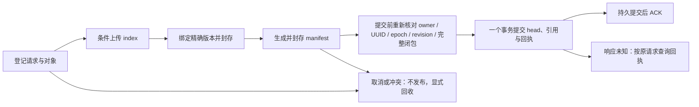
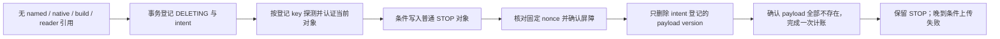

# R6 远程对象所有权与原子发布协议

本轮基于 [Draft #90](https://github.com/AstroVela/ducklake/pull/90) 的 `48293724a8d3b0652a689a7c85e01e7892369ca8`，交付远程协议设计、可执行模型、独立 oracle 与确定性验证。总入口为 [DuckLake＋Vortex 总设计与 roadmap](ducklake-vortex-design-roadmap.md)。**生产 `src/`、SQL 接口、provider、依赖 pin 和 native DuckDB 限制沿用 #90；本轮没有接入真实 PostgreSQL／S3，也没有完成分布式 ANN。**

本地验证固定 CPU **6–11**，继承现有线程环境；既有原生测试的 DuckDB `threads=2` 设置保持。本模型不创建 DuckDB 或 ANN 线程。保留事务保护与预算，继续暂缓 R4 A/A、性能 A/B、长期稳态及依赖稳定负载的 R5 资格测试；耗时只记录为观察值。

后续的 [PostgreSQL／S3 最小 backend](native-vortex-postgres-s3-backend.md)已把协议接到真实 PostgreSQL 与 MinIO API。它明确采用 broker 签发条件 SigV4 票据作为唯一 worker 授权方式，补充实际服务的原子发布、未知响应与 GC 验证；本文件继续保留 #91 的模型基线及历史结果。Vane 原生远程 SQL 与 ANN 仍未接入。

## 现有能力与待替换的本地假设

| 当前实现证据 | 远程协议需要的能力 |
| --- | --- |
| [metadata manager](../src/storage/ducklake_metadata_manager.cpp) 已有 PostgreSQL、SQLite 等通用入口；[Vortex catalog](../src/storage/ducklake_vortex_index_catalog.cpp) 的 `Begin` 显式要求 native DuckDB | 选定一个事务性远程 metadata 后端，逐项验证 UUID、epoch、数值、LIST、BLOB／NUL 和回执编码后再移除此限制 |
| [index catalog](../src/storage/ducklake_vortex_index_catalog.cpp) 使用 `realpath`、普通文件／尺寸／SHA 校验、进程内 publication／collection 锁与本地封存 | 不可变对象的精确 version ID、长度与内容摘要，以及跨进程 owner fencing 和 metadata CAS |
| [source retention](../src/storage/ducklake_vortex_source_retention.cpp) 与 [GC I/O](../src/include/common/ducklake_vortex_gc_io.hpp) 使用 inode、`openat`、`O_NOFOLLOW`、`unlink`、目录 `fsync` | 受登记清单约束的远程删除意图、条件写屏障与指定版本删除，不能把远程 URI 当成本地目录 |
| [ReadView](../src/storage/ducklake_vortex_read_view.cpp) 固定原生快照、输入身份并持有受保护的私有资源；普通事务阻止 source GC | 与发布／GC 共享事务协调的持久 pin，或已完整验证的私有副本；owner 切换不能撤销读者保护 |
| [Rust build](../src/vortex_query/src/build.rs) 与 [scratch](../src/vortex_query/src/scratch.rs) 使用本地 pending／rename、文件锁与 `fsync` | 远程 SDK 与显式下载缓存所有权；先认证完整输入，再调用既有 vortex-index／SPFresh |

Vane 的 pin 已包含通用 `httpfs`，文件系统也提供版本标签接口；这些接口本身没有证明 Vortex 生命周期所需的条件创建、精确版本回收和跨后端原子性。远程路径必须逐项具备下面的能力；缺少能力直接拒绝，不增加本地兼容路径或 fallback。

## 首个候选能力配置

选择 **PostgreSQL 事务元数据＋开启版本管理的通用 S3 bucket** 作为下一阶段真实 adapter 的目标，不同时实现多种云语义。本轮只是模型中的能力配置，不声称已经部署或验证该服务。

- Payload 只使用单次 `PutObject` 与 `If-None-Match: *`；每个登记对象最多 64 MiB，不在首版引入 multipart。服务成功响应表示完整对象已经写入；响应丢失仍属于待核对结果。[S3 PutObject](https://docs.aws.amazon.com/AmazonS3/latest/API/API_PutObject.html)
- 精确保存 `(bucket, key, version_id, size, SHA-256)`；GET 和 DELETE 指定版本。ETag 只作条件令牌，不当作内容 SHA 或 MD5。简单 DELETE、最新版本 DELETE 和指定版本 DELETE 不能混用。[S3 版本工作流](https://docs.aws.amazon.com/AmazonS3/latest/userguide/versioning-workflows.html)、[删除对象版本](https://docs.aws.amazon.com/AmazonS3/latest/userguide/DeletingObjectVersions.html)
- 当前版本为空或为 S3 delete marker 时，`If-None-Match: *` 可以成功；`If-Match` 可约束替换当前对象。因此 GC 需要保留普通 STOP 对象阻挡晚到上传。[S3 条件写语义](https://docs.aws.amazon.com/AmazonS3/latest/userguide/conditional-writes.html)
- 应用凭证、bucket policy 与 lifecycle 配置须共同保证：payload 只能条件创建；普通写者不能覆盖或删除 STOP；协议前缀不受外部自动清理影响。策略可以强制条件写头，但所需隔离仍须用真实凭证测试，不能靠模型假定已经配置。[S3 条件写策略](https://docs.aws.amazon.com/AmazonS3/latest/userguide/conditional-writes-enforce.html)
- Metadata 的 owner、请求、索引头、引用、读者 pin、GC intent 与回执都处于同一事务数据库。写者按固定顺序锁 owner、索引头、对象清单与引用，验证后提交。行锁在事务结束时释放；故障切换与提交确认的持久性另需按 PostgreSQL 的 WAL／同步提交配置验证。[PostgreSQL 显式锁](https://www.postgresql.org/docs/current/explicit-locking.html)、[WAL 配置](https://www.postgresql.org/docs/current/runtime-config-wal.html#GUC-SYNCHRONOUS-COMMIT)

不依赖对象 LIST 枚举来寻找可回收对象，也不依赖目录 rename 或进程内锁实现跨主机发布。远程对象写入与数据库提交没有共同事务：通过先封存、再原子发布，以及可恢复的回收意图来协调。

## 身份与所有权

| 身份／记录 | 约束 |
| --- | --- |
| Catalog owner epoch | 持久单调递增的 fencing token。接管必须 CAS 旧值；每个 metadata 写事务提交前重新核对。它与业务 `request_epoch` 不同 |
| 请求 | 固定 `(table_uuid, request_epoch, request_id, payload_hash, expected_revision, input_snapshot)`；重试、接管与结果核对都不改身份，不自动 rebase 到最新 revision |
| 对象登记 | 上传前登记 key、角色、内容摘要、尺寸、所属 generation／source。key 隔离 catalog、table UUID、创建 owner、attempt 和角色；不重用旧 key |
| 对象封存 | 绑定完整 payload 的精确 version ID、尺寸、SHA。Manifest 再绑定 source／index 的精确版本及输入快照，封存后不可修改 |
| 引用 | 区分 current named root、native 历史、构建输入、ReadView pin；解除命名引用不等于解除 native 历史引用 |
| GC intent | 记录不可变 unit 身份、固定 nonce、每个 key 的 payload version、STOP 状态和完成回执。新 owner 显式接管原 intent，不能换 key 或清扫邻居 |
| 提交回执 | 与 named revision／完整引用集同事务提交；重试返回原请求回执，即使已有更新的 head |

控制 owner 的失效只阻止旧进程继续修改 metadata，**不会撤销已经发出的远程 RPC**。旧上传、旧条件 STOP 和旧精确 DELETE 都允许在接管、取消甚至 GC 完成后才返回；恢复协议必须容纳这些情况。这里只允许已经登记且获授权的操作晚到，不把任意旧凭证写入视为合法协议行为。

## 发布与 ACK



模型的 `begin / stage(head, refs, receipt) / commit` 把本地暂存与持久事务区分开：stage 不能改变可见 head 或引用。真实 adapter 应在同一个数据库事务内锁定身份和版本，校验对象仍可发布，然后一起写 head、引用与回执；不能把三个独立 SQL 提交包装成“原子发布”。本模型的内存 stage 只是交错探索用的抽象，不证明 PostgreSQL 驱动已经实现该事务。

提交前必须重新检查 owner、请求未取消、原 expected revision、输入快照／引用和封存闭包。仅在 BEGIN 检查会留下“暂存后取消或回收，随后仍提交”的窗口。CAS 冲突直接返回；恢复可以明确 adopt 未完成请求，但不能改写其原 revision。调用方若决定提交不同输入，应创建不同请求。

成功提交、ACK 丢失时按原 UUID／epoch／request ID 和 payload hash 核对回执，不从最新 head 推断旧请求成功。Metadata WAL 仍由所选事务数据库负责，不为这一协议再引入第二份客户端 WAL。真实服务必须另行验证确认提交在所选故障域内的持久性；模型的“durable”是前提，不是对真实云存储的掉电保证。

## ReadView 与事务保护

捕获 ReadView 时，在一个 metadata 事务里读取 committed root／输入快照并登记其完整 source／generation pin，与发布和 GC 使用同一锁定顺序。不能先读 head、稍后再 pin；pin 时若对象已经 DELETING，捕获失败。一个视图的向量、可见性、过滤和业务列仍绑定同一快照，后续分布式 fan-out 也须携带这一个身份。

Reader session 与 writer owner 分开。更换 owner、重开 writer 或 metadata checkpoint 都不能删除活跃 reader pin。普通 SQL 事务继续阻止 native 历史过期与 source 删除，包括与目标文件无关的普通事务；不把检查缩小成“只查向量读者”。

读者只有在精确版本的全部字节已下载、尺寸和 SHA 验证完成、私有资源已登记后，才可显式解除远程 pin。规范对象被回收后，完整私有副本仍归该读者所有。模型验证的是副本身份保持，不执行真实 ANN；真实缓存仍须复用本地 scratch 的活跃保护和预算。**不以 TTL 到期直接删除 pin**；reader 故障的安全 session fencing／pin 回收属于后续真实 adapter 工作。

## GC：先阻止晚到上传，再删除指定 payload 版本



1. 在 metadata 事务内重新核对所有引用及普通事务保护，按共享预算接纳 unit，并先持久标记 DELETING。之后禁止新的发布／pin 引用它。
2. 每个登记 key 若尚不存在，持久记录空 target，发送 `If-None-Match: *` 的 STOP；若当前是登记的完整 payload，认证尺寸／SHA、保存其 version ID，再用其 opaque ETag 作 `If-Match` 写 STOP。STOP 包含 catalog、UUID、key、intent nonce，是小型普通对象。
3. HEAD 与 STOP 间若旧上传先到，条件 STOP 失败。当前 owner 显式重新探测同一 intent，记录新出现的确切 payload 版本，再发条件 STOP；不改请求、不接管未知内容。当前已是匹配 nonce 的 STOP 时，只补齐 metadata 确认。
4. 每个屏障确认后，删除对应的确切 payload version。空 target 没有 payload 可删；未知响应先按原 version 核对。禁止无版本 DELETE、按“当前版本”删除、删除 STOP 或扫描陌生 key。旧 collector 已发出的 DELETE 只可能影响同一个退休 payload。
5. 所有登记 payload 均不存在且 STOP 完整后，持久完成回执。重开不隐式回收；显式恢复保留原 nonce，按当前轮预算重新接纳，完成只计账一次。

反例的具体顺序是：旧 payload PUT 已发出但未生效 → 取消并接管 → GC 完成 → 旧 PUT 才生效。若只撤销 metadata owner、只删除 payload、删除屏障或使用 S3 delete marker，key 仍可能重新接收旧 payload。普通 STOP 令旧条件创建失败；它不是把 S3 delete marker 换一个名字。条件屏障是本协议的必要能力，缺失时拒绝该后端。

STOP 需要保留到能够独立证明旧凭证和所有在途写入均不再生效。本版不实现这种证明，因此不清理 STOP。**小对象与版本元数据会累积**；这不构成远程总磁盘、对象数、成本或 RSS 上界。Lifecycle 策略擅自删除 STOP 会破坏协议，真实 adapter 必须验证保护配置并拒绝不满足要求的配置。

## 预算与模型范围

既有生产预算没有改变：共享 source、artifact、vector 各 64 MiB，manifest 1 MiB，最多 100,000 个物理行、维度 1–4096、最多三个 B；静态构建至少 65 行。模型对候选 generation 的符号输入检查相同边界，不声称覆盖真实多 B 编码／全局资源测量；这些仍由 [R5 admission 验证](native-vortex-capacity-admission.md) 负责。

每轮 GC 最多 16 个逻辑 unit、64 MiB；模型 source 按登记源字节，generation 按登记 artifact 字节收费，manifest／STOP 不单独增加逻辑 unit。恢复保守预留该 unit 的原始费用；只完成一次逻辑计账。STOP、协议 metadata、探测／验证读取、数据库 WAL 和网络请求不等于该字节限额。模型覆盖 16／17 个 unit、共享恰好 64 MiB／再多 1 字节、重复完成和跨 owner 续作，不增加任何预算绕过。

## 可执行验证与独立 oracle

[协议模型](../test/vane/vortex_remote_protocol.py) 只用 Python 标准库实现 metadata、版本对象服务、可延迟／重复的 RPC、reader pin 和进程局部状态。[独立 oracle](../test/vane/vortex_remote_oracle.py) 不调用模型的 fencing、引用计算、manifest 构造或 GC 判定函数；它从提交历史、原始对象版本与物理副作用重建约束。[coordinator](../test/vane/test_vane_vortex_remote_protocol.py) 保留命令 trace、拒绝原因、源码 SHA 与状态集合摘要。

```bash
python3 -I test/vane/test_vane_vortex_remote_protocol.py \
  --cpus 6,7,8,9,10,11 --output-dir /fresh/remote-publication-proof
```

`rule.json` 在执行前写入固定探索深度与状态上限。拒绝的命令必须逐字保持原状态；每个成功转移都校验 oracle。达到预设状态上限直接失败，不截断后宣称通过。两个 kernel 分别为：

| Kernel | 有界输入与动作 | 深度 |
| --- | --- | --- |
| publication | 一个 ready 候选、两个 owner、一个 reader；begin／三个 stage／commit／cancel、接管／adopt、捕获／复制／解除 pin／close、writer crash | 10 |
| late-upload-gc | 一个已取消候选、两个 key、一个 GC intent、一个已发出的 index PUT 及一个复制 RPC；STOP 探测／条件竞争、指定版本 DELETE、完成 | 12 |

固定场景另覆盖竞争 revision、不改身份的 adopt、旧回执、新 head、部分／损坏上传、UUID／epoch 拒绝、共享预算、普通 SQL 全局保护、native 引用独立性、跨 owner GC 和旧私有视图。发布逐项插入 13 个逻辑 crash cut，GC 插入 7 个逻辑 crash cut；清除对应 writer 的局部 frame／round 后显式恢复，已经发出的 RPC 可以继续到达。这是逻辑故障探索，**没有真实 SIGKILL、真实数据库重启或服务端故障注入**。

18 个故意不安全的协议变体必须各自触发 oracle：移除 owner fence、revision CAS、提交前复核、摘要校验；拆分原子发布；混合视图、接管时丢 pin、adopt 改身份、回执跟随 head；绕过引用、预算、普通事务；缺少 STOP、误删当前版本、删除 STOP、扫陌生 key、无条件 PUT、把 STOP 换成 delete marker。反例保存完整轨迹，不把变体被模型拒绝误计为 oracle 找到反例。

模型里的尺寸和 SHA 是固定 fixture 的符号身份；它没有实现 Vortex 字节编码、真实 SHA 下载校验、PG 类型编码、S3 SDK、网络鉴权、时间／lease、reader 故障回收、跨 catalog 或任意数量进程。它验证安全性和固定恢复序列，不能证明公平调度、最终完成、服务可用性或性能。

## 本轮结果

冻结验证通过 **39 个固定场景、18 个不安全变体反例**。两个 kernel 合计 **1,342 个状态、21,036 次动作尝试、7,050 次成功转移**；每个拒绝动作均保持状态不变。状态数按各自独立初始条件分别统计，不把两个 kernel 称为完整的全系统探索。

| Kernel | 深度 | 状态 | 动作尝试 | 成功转移 | 状态集合 SHA-256 |
| --- | --- | --- | --- | --- | --- |
| publication | 10 | 905 | 15,100 | 5,525 | `c3f1202d366f4def12cb8cb8505a913b3fb27086fbb3d750256c69bae1d432f8` |
| late-upload-gc | 12 | 437 | 5,936 | 1,525 | `7115d8f137383e36cad90fcd8290ce59d0d495b64b17889510a4014d2f35b51b` |

主报告为 `/tmp/ducklake-vortex-remote-publication-proof-v2-20261106/report.json`，SHA-256 **`915b978cd8919d61959e030de2186f416b966e49df945ae5bcbb9dcaf3d8ea7d`**。报告包含全部固定场景与反例轨迹、两个状态集合摘要、执行源码 SHA、CPU 6–11、继承的线程环境和 affinity 恢复核对；源码执行前后及冻结后复核一致。`rule.json` 保留预先声明的探索规则。

Vane 基础 launcher 按原方式分为非 Ray 与 Ray 进程，在相同 CPU 集合通过 **1,222＋32＝1,254 项**，可选依赖缺失跳过 **11＋4＝15 项**，日志为 `/tmp/ducklake-vortex-remote-base-20261106.log`。格式检查、文档相对链接、workflow YAML、copyleft 检查通过；本轮未重建 native 构件。

| 保持 #90 的安装构件 | SHA-256 |
| --- | --- |
| Vane `_native` | `8ca20bd4c8a4203f239ff6d785c45575241d3b2c8d1f8e9fc184d90de1d54876` |
| DuckLake provider artifact | `70106b76f9951f9657d546c5b50eac7d8b5a0dde518c513bb7e6fbc6a40d2f3f` |
| Vortex provider artifact | `16cc10c2bb607f539618a0887a5551f41eae51c2bd981fdb063d3c2536a85495` |

CI 在 native 构建前单独运行相同的标准库模型并留存 rule／report，不需要云凭证或 native provider。Hosted runner 显式选择可用 CPU 并记入报告；本轮本地证据固定 CPU 6–11。远端 CI 状态以 Draft PR 为准，这些本地结果不代替远端检查。

## 下一阶段

R6 仍未完成。下一份应实现上述**单一真实后端的最小 adapter 与能力 conformance**：先在隔离服务中验证版本化条件创建、STOP 替换与保护、精确 GET／DELETE、未知响应核对，再验证 PostgreSQL 同事务 CAS／引用／回执及提交故障切换。沿用本轮固定故障序列，不能以模型通过代替真实服务证据。

移除 native DuckDB 限制前，还须补齐远程 metadata 的 Float32、NULL、LIST、NUL／BLOB、UUID／epoch 生命周期、普通事务保护与 typed ReadView 验收；建立 reader session fencing、持久 pin 回收和认证私有缓存契约。之后才接固定 ReadView 的 Vane fan-out、读位置等待、分布式 top-k 与 owner 故障恢复。既有 vortex-index／SPFresh 静态 B 继续复用；R7 原生在线更新不由本次协议模型顺带宣称接入。
